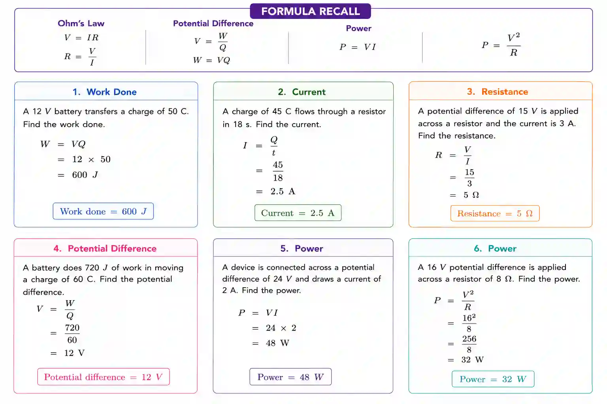

## Potential difference and power

### Potential Difference

Potential difference across a component as the energy transferred per unit charge

* unit - Volts - V (Joule per coulomb)

* Formula - $V=\frac{W}{Q}$

  * V - Voltage

  * W - Work done

  * Q - charge

* $P=\frac{W}{t}$ so if we substitute $W=VQ$ into Power equation we get $P=\frac{VQ}{t}$ which is equal to $P=VI$ (refer current formula from before)

* $P = I^{2}R$ , $P=\frac{V^{2}}{R}$ (use Ohm’s law for substitution)

  * P - Power

  * I - Current

  * R - Resistance

  * V - Voltage

* Since $P=VI$ & $E=Pt$ $\rightarrow$ $E=VIt$

  * E - Energy (J)

### Example Problem

