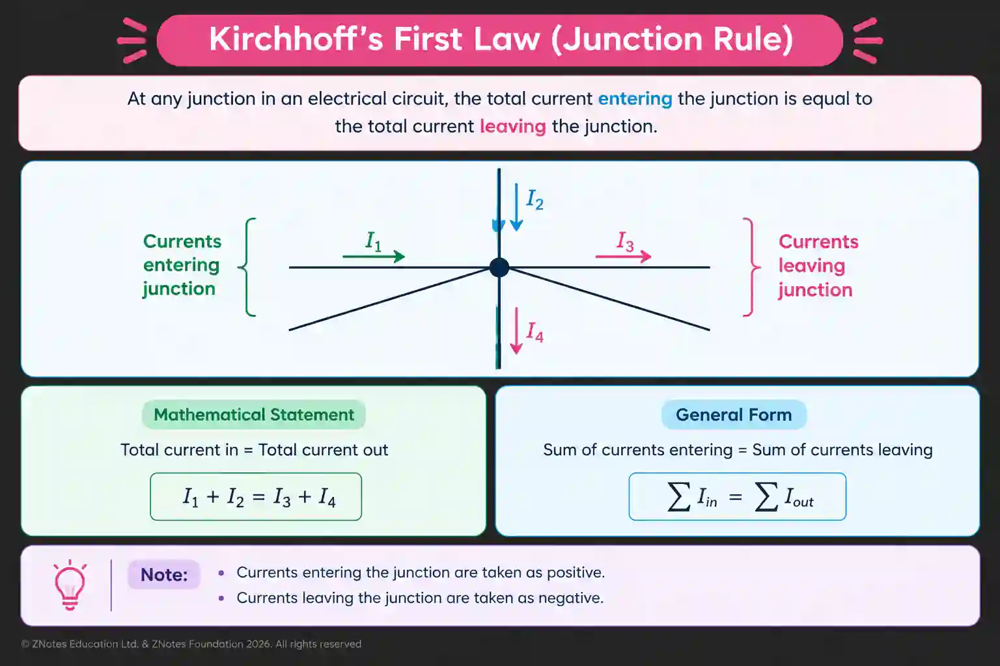
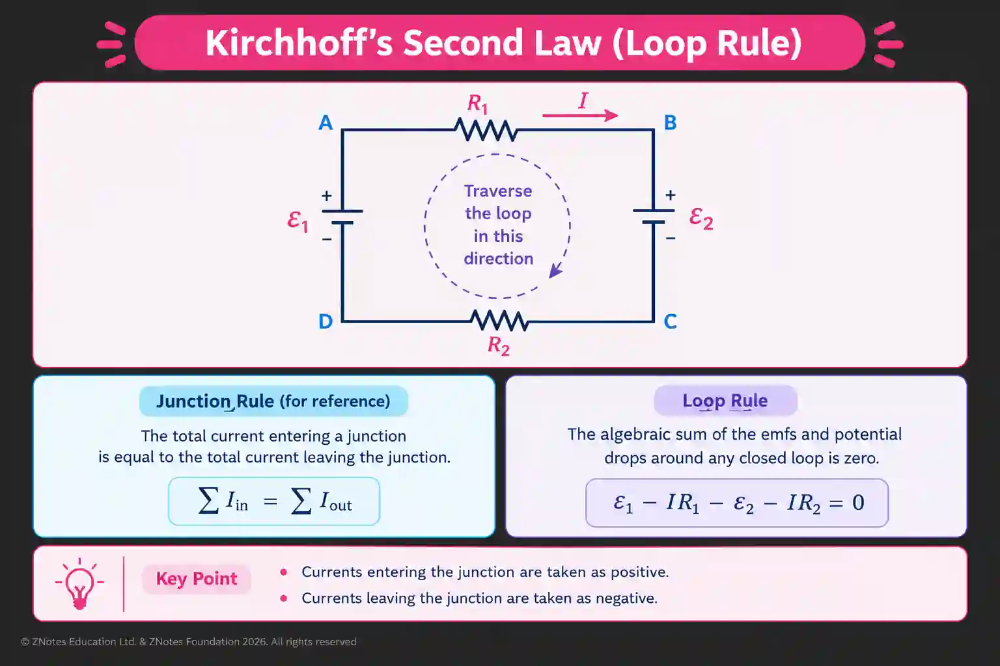

## Kirchhoff’s laws

#|
||

Type of Law

|

Kirchhoff’s 1st law

|

Kirchhoff’s 2nd law

||
||

Law

|

*The sum of currents in a junction* is equal to

*the sum of currents out of the junction.*

|

The algebraic sum of all voltages around any closed loop in a circuit must equal zero.

Alternatively, the total electromotive force (EMF) supplied in a loop equals the sum of the potential drops (voltage used by components)

||
||

Consequence of

|

Law of conservation of charge

|

Law of conservation of energy

||
||

Deriving Resistance

|

For Parallel Circuit

$I = \sum I$

$I = I_{1} + I_{2}$​

$\frac{V}{R} = \frac{V}{R_{1}} + \frac{V}{R_{2}}$​

Voltage constant therefore cancel:

$\frac{1}{R} = \frac{1}{R_{1}} + \frac{1}{R_{2}}$​

|

For Series Circuit

$E = \sum IR$

$IR = IR_{1} + IR_{2}$​

Current constant therefore cancel:

$R = R_{1} + R_{2}$​

||
|#

### Worked examples

Question :

A circuit contains two loops. The left loop has a 6.0 V cell and a 2.0 Ω resistor. The right loop has a 4.0 V cell and a 3.0 Ω. The two loops share a 1.0 Ω resistor.

Let the currents in the left and right branches be $I_1$ and $I_2$.

**(a)** Apply **Kirchhoff's first law** at the junction to write an equation relating the currents.

**(b)** Apply **Kirchhoff's second law** to each loop to obtain two simultaneous equations.

**(c)** Solve the equations to determine $I_1$ and $I_2$.

**(d)** Calculate the current through the shared resistor.

Ans :

**(a)** $\boxed{I_{out}= I_1 +I_2}$

**(b)** 6.0 = 2.0$I_1$ ​\+ 1.0$I$ - Loop 1

4\.0 = 3.0$I_2$​ \+ 1.0$I$ - Loop 2

6\.0 =2$I_1$​\+$I_1$​\+$I_2$( substitute $I_{out}= I_1 +I_2$ into equation )

$\boxed{3I_1 + I_2 = 6.0}$

4\.0 =3$I_2$ ​\+ $I_1$​ \+ $I_2​$

$\boxed{I_1 + 4I_2 = 4.0}$

**(c)** $3I_2 ​+ I_2 ​= 6$

$I_1​ + 4I_2​ = 4$

$I2​ = 6− 3I_1​$ ( from 1st equation )

$I_1​ + 4(6 − 3I_1​)= 4$

$I_1 + 24 − 12I_1= 4I_1 + 24 - 12I_1 = 4$

$−11I_1​=−20$

$\boxed{I_1 = 1.82A}$

$I_2​ = 6 − 3(1.82)$

$\boxed{I_2 = 0.545A}$

**(d)** $I= I_1 +I_2$

$I=1.82+0.545$

$\boxed{I = 2.37A}$

​