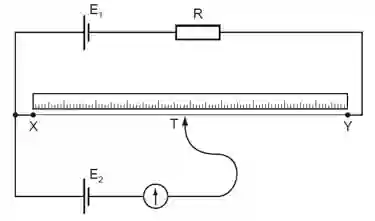

## Potential Divider

### Principle of Potential Divider Circuit

Note - refer to circuit diagram when reading the notes

A **potential divider** is a circuit that uses **two or more resistors connected in series** to divide an input voltage into smaller voltages.

The output voltage is taken across one of the resistors.

$\boxed{V_{out} = V_{in}\frac{R_2}{R_1+R_2}}$

* Since resistors in series - $R_{total} = R_1 + R_2$

* Therefore it is $\boxed{\frac{V_{out}}{V_{in}}=\frac{R_2}{R_1+R_2}}$

* The voltage divides between the resistors **in proportion to their resistances**.

* So, the larger the resistance, the larger the share of the input voltage across it.

**Using a thermistor in potential divider :**

* A **thermistor** is a temperature-dependent resistor.

* If the thermistor is used as $R_1$:

  * Temperature increases

  * $R_1$ decreases

  * $R_1$ \+ $R_2$ decreases

  * The fraction of voltage across $R_2$ changes

  * Therefore, $V_{out}$ changes

**Using an LDR in a Potential Divider**

* If the LDR is used as $R_1$:

  * Light intensity increases

  * $R_1$ decreases

  * The voltage division changes

  * Therefore, $V_{out}$ changes

### Example applications

* Automatic lighting systems

* Light sensors

* Street-light control

* Brightness detection

### Potentiometer

* Null method - A method where the reading on the galvanometer is zero.

  A potentiometer is a **continuously variable potential divider** used to **compare potential differences**.

  * The potentiometer wire has a **uniform resistance**, so resistance is proportional to length: R∝L

  From V=IR

  with constant current through the wire: V∝R

  Therefore: V∝L

  * ### Comparing potential differences

    * A **galvanometer and sliding contact** are used to find a point on the potentiometer wire where the potential difference across the required length is equal to the e.m.f. of the cell.

    * The sliding contact is moved along the wire until the **galvanometer reads zero**.

    * This is called the **null method**:

    Null point=galvanometer reading 0

    * At the null point, **no current flows through the galvanometer**, so the cell being measured does not supply current to the measuring circuit.

    * Therefore, the cell's **internal resistance does not affect the measurement**, giving an accurate comparison of potential differences.

    ### Finding an unknown e.m.f.

    * First balance the known cell $E_1$ and measure the balancing length $L_{XY}$

    * Then replace it with the unknown cell $E_2$ and move the sliding contact until the galvanometer again reads zero.

    * Measure the new balancing length $L_{XT}$.

    * Since potential difference is proportional to balancing length:

    $\boxed{\frac{E_1}{E_2}=\frac{L_{XY}}{L_{XT}}}$

    * Hence, if $E_1$ and the two balancing lengths are known, the **unknown e.m.f. $E_2$** can be calculated.

### Worked example

A potentiometer wire is 1.5 m long. A standard cell of emf **1.20 V** gives a balance length of **60 cm**. When an unknown cell is connected, the balance length is **85 cm**.

**(a)** Calculate the emf of the unknown cell.
**(b)** State the assumption made when using the potentiometer equation.

Solution :

a) $\frac{E_1}{E_2}=\frac{l_1}{l_2}$

$\frac{1.20}{E_2}=\frac{60}{85}$

$\ E_2=\frac{1.20\times85}{60}$

$\boxed{E_2=1.70\mathrm{V}}$

b) The potential gradient along the potentiometer wire remains constant.