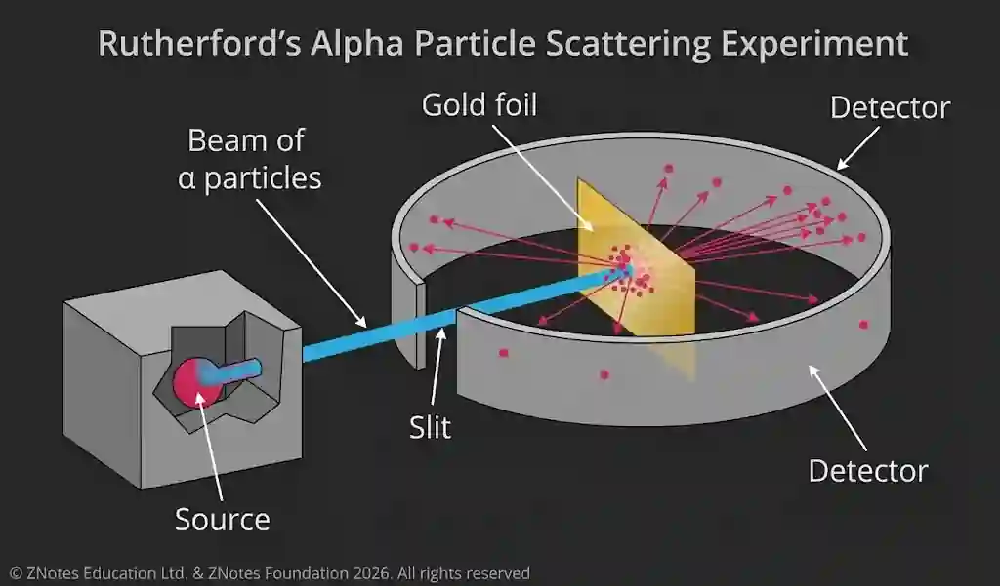

# Particle Physics

## Atoms, nuclei and radiation

### $\alpha$-particle scattering experiment

### Results & Conclusion

#|
||

Result

|

Conclusion

||
||

Most particles pass straight through

|

Most of an atom is empty space

||
||

Some are scattered appreciably ($<10$ degrees)

|

All mass and charge concentrated in the center of atom ∴ nucleus is small and very dense

||
||

Very few – 1 in 8,000 – suffered deflections $>90º$

|

Nucleus is positively charged as *α*-particles are repelled/deflected

||
|#

### Structure of an Atom

The nucleus in the center is made of protons & neutrons

Electrons are present in orbitals / shells around the nucleus

* **Proton number** -  (also the atomic number) number of protons in an atom

* **Nucleon number** (Mass number) - The total number of protons & neutrons in an atom

* **Isotopes** - forms of the same element with different numbers of neutrons in their nuclei

* **Nuclide notation:** ${ }^{A}_{Z}X$

  * A: nucleon number
  * Z: proton number
  * X: element

* Unified atomic mass unit ( u ) - $\frac{1}{12}$ mass of a carbon-12 atom

  * 1 u = $1.66\times10^{-27}\mathrm{kg}$

### Nuclear Processes

Nuclear process such as fission & fusion tend to conserve nuclear charge & mass.

#|
||

Nuclear process

|

Nuclear Fusion

|

Nuclear Fission

||
||

Definition

|

Two light nuclei combine to form a heavier nucleus.

|

A heavy nucleus splits into two smaller nuclei.

||
||

Type of Nuclei

|

Light nuclei, such as hydrogen isotopes

|

Heavy nuclei, such as uranium-235

||
||

Energy released

|

A large amount of energy is released because some mass is converted into energy.

|

A large amount of energy is released because some mass is converted into energy.

||
||

Neutron

|

A neutron can be produced in the reaction.

|

Several neutrons can be released, which can cause further fission reactions.

||
||

Chain reaction

|

Does not normally occur as a neutron-driven chain reaction.

|

Can produce a chain reaction because released neutrons can cause further fission.

||
||

Conditions

|

Requires extremely high temperature and pressure to overcome repulsion between nuclei.

|

Can be initiated when a suitable heavy nucleus absorbs a neutron.

||
|#

Nuclear fission & fusion reactions equations

### Types of Radiation

#|
||

Types of Radiation

|

$\alpha$

|

$\beta$

|

γ

||
||

Charge

|

$+2$

|

$-1$ ($β^-$) or $+1$ ($β^+$)

|

0

||
||

Penetration

|

least

|

more than α but less than γ

|

highest

||
||

Ionisation

|

highest

|

more than γ but less than $\alpha$

|

least

||
||

Protection

|

paper

|

Few mm of aluminium

|

thick lead sheet (several centimeters)

||
||

Deflection in magnetic field

|

Deflected slightly

|

Deflected more

|

not deflected

||
||

Deflection in electric field

|

Attracted to $-$ve

|

Attracted to $+$ve

|

not deflected

||
||

Symbol

|

${ }^{4}_{2}He$

|

${ }^0_{-1}e^- / { }^0_{1}e^+$

|

${ }^{0}_{0}{\gamma}$

||
||

Identity

|

helium nuclei

|

fast moving electron

|

electromagnetic

||
||

Mass

|

4

|

1/1840

|

0

||
||

Force

|

Strong interaction

|

Weak interaction

|

$-$

||
||

Energy

|

Discrete

|

Continuous range

|

$-$

||
||

Speed

|

slow ( $10^7  ms^{-1}$ )

|

faster than α but slower than γ ( $10^8  ms^{-1}$ )

|

speed of light  ($3 \times 10^8 ms^{-1}$)

||
|#

* Antiparticle - antiparticle has the same mass but opposite charge to the corresponding particle,

* A positron is the antiparticle of an electron

### α & β decay

#|
||

Type of decay

|

α decay

|

$β^-$ decay

|

$β^+$ decay

||
||

What happens in nucleus?

|

A nucleus emits an α-particle (helium nucleus).

|

A **neutron changes into a proton.**

|

A **proton changes into a neutron**.

||
||

Particle that is emitted

|

$\alpha_{2}^{4}$

|

Electron $β^-$ and electron antineutrino $ν_{e}^-$

|

Positron $β^+$ and **electron neutrino** $ν_e$

||
||

Energy distribution

|

Discrete energies

|

Continuous range of energies

|

Continuous range of energies

||
||

Why?

|

α-particles are emitted with specific energies.

|

Energy is shared between the electron and antineutrino.

|

Energy is shared between the positron and neutrino.

||
||

changes

|

$A \rightarrow A−4$, $Z \rightarrow Z−2$

|

$A \rightarrow A$, $Z \rightarrow Z+1$

|

$A \rightarrow A$, $Z \rightarrow Z−1$

||
|#

**α decay equation formula and example**

**$β^-$ decay equation formula and example**

**$β^+$ decay equation formula and example**

