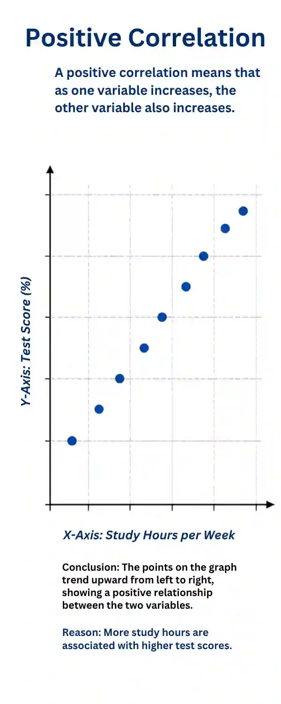
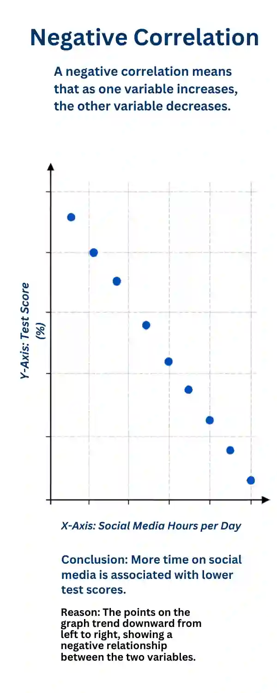
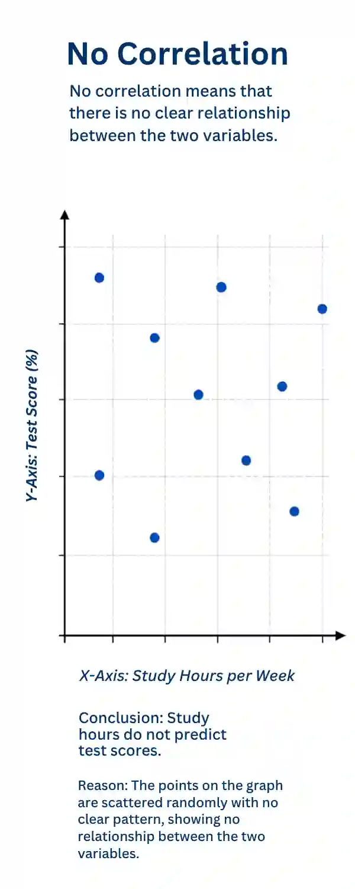

## Correlations

* A statistical technique that measures the extent which two variables are related. This analyses the relationship between co-variables, A change in one variable can correspond with  a change
  in the other; however, correlation does not imply causation.
  None of the variables are manipulated, they are only measured.
* A positive correlation is a relationship in which the change in
  one variable accompanies the change in the other.

  
* A negative correlation is a relationship in which the increase in
  one variable accompanies a decrease in the other.

  
* No correlation refers to a situation where no definite trend
  occurs and the two mentioned variables do not appear to be related
  to each other.

  
* It ranges from -1 to \+1:
  \-1.0 = perfect negative correlation
  0 = no correlation
  \+1.0 = perfect positive correlation

The table below compares the strengths and weaknesses of investigating correlation.

#|
||

Strength

|

Weaknesses

||
||

Correlations allow researchers to identify relationships between variables.

|

Issues of causality because there could be a third variable affecting the changes.

||
||

Correlations do not require any manipulation so can be used where experiments are unethical or impractical.

|

Correlations are restricted to research that are quantitative and so they cannot be used to measure why behaviors are occurring.

||
|#

