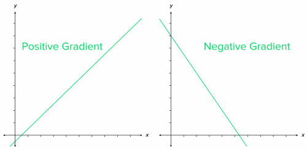
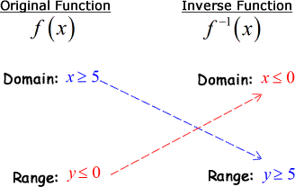
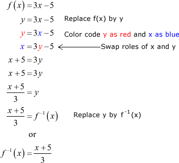

# Sequences, Functions and Graphs

## Graphs

* A linear graph is a graph in the form of a line.

* All graphs have y-axes and x-axes

* X-axes are horizontal while y-axes are vertical

* A linear graph has the formula of *y=mx+c*, where m is the gradient and c is the y-intercept.

* The gradient of a graph is the steepness of it

* If the value of the gradient is positive, the line is going upwards

* If the value of the gradient is negative, the line is going downwards

* The intersection of two points in a linear graph is the solution to the pair of lines/simultaneous equations.

  

* Graphs of direct proportion cross the origin (0,0).

* The inverse of a linear function is different from a linear function, as it’s domain and ranges are opposites.

E.g. Find the inverse of *f(x) = 3x-5*

