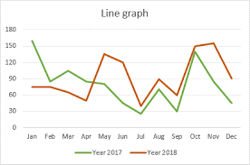

## Line Graphs 

 

* The point at which the line month on the x-axis meets with a value on the y-axis and is on the given line, is the answer for the question.
* E.g. Find the total sales in the month of October.
* October meets with the value 150 on the number line, so the answer is 150 units.
* To interpret a graph or chart, read the title, look at the key, read the labels. Then study the graph to understand what it shows. 
* Read the title of the graph or chart. The title tells what information is being displayed. 
* To relate the results to the original question, we must find all the data given and then try to solve the question.

