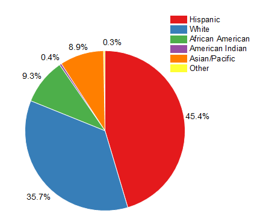

## Pie Charts

* A pie chart a type of graph in which a circle is divided into sectors that each represent a proportion of the whole.
*  
* Comparing data from pie charts can be done by taking the percentage of each set of data.
