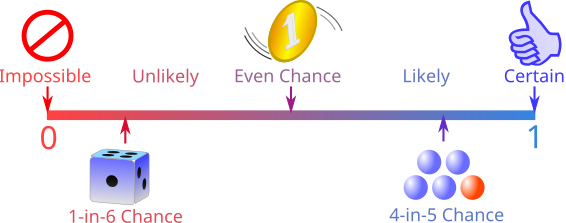

# Probability

## Introduction

- The math of chance

- How often an event happens over total possibilities

- Represented using fractions, decimals or percentages

- The range of fractional probability should be between 0 and 1

Fractional Probability = $\frac{Number\ of\ chances\ of\ it\ happening}{Total\ number\ of\ outcomes}$
Example: $\frac{3}{5}$ ==> Out of 5 outcomes, there are 3 chances of it happening.

## Probability line:

- Impossible = 0

- 0 < Unlikely Chance < $\frac{1}{2}$

- Even Chance = $\frac{1}{2}$

- 1 < Likely Chance < $\frac{1}{2}$

- 1 = Certain, definite or 100%