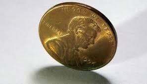

## Theoretical and Experimental Probability

### Theoretical Probability

- Probability based on reasoning or on mathematical calculation

Example: If a coin is tossed twice, by theoretical probability, the chance of it getting on a head is 0.5 or $\frac{1}{2}$

### Experimental Probability

- Probability based on multiple experiments

- Example: A statistician flipped a coin 24,000 times, and 12,012 of them were heads. Based on his experiments, we can say that the probability of getting heads is $\frac{12,012}{24,000}$, which is 0.5005 in decimals.

- This is purely based on experimental data.