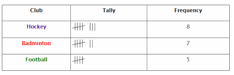

## Mean, Median and Mode

* There are three terms commonly used in data analysis: mean, median, and mode.
* The **mean** of a sequence can be determined by taking the average of the sequence, by adding all the values and dividing it by the number of items/elements in the sequence.
* The **median** can be taken by arranging the elements of the sequence in ascending order, then picking the middle number in the new sequence.
  * Note that while taking the median in a sequence with an even number of a sequence, we must add the two middle numbers and then divide it by 2.
* The **mode** of the sequence is most frequently occuring element.

**Mean**: Multiply each club’s frequency by its number of students, add them up, then divide by the total number of students.

$\frac{(8×8) + (7×7) + (5×5)}{20} $

= 6.9

**Median**: List all values in order (5s, 7s, 8s), then find the middle one.
Since there are 20 values, the median is the average of the 10th and 11th → **7**

**Mode**: The value that appears the most is **8** (Hockey students), so the mode is **8**.