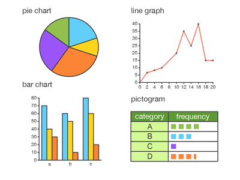

## **Processing and Presenting Data**

**Stage 7**

* The mean of a sequence is its average $\frac{Sum\ of\ Samples}{Number\ of\ Samples}$
* The mode of a sequence is its most frequently occuring element.
* The median of a sequence is its middle value.
* The range of a sequence is the difference between its largest and smallest values.
* A frequency table/diagram contains values, tally marks and frequency.
* Bar charts are charts that use bars to represent values.
* A pie chart uses a circle divided into different sectors that represent values.
* A line graph is a graph with a line which represents each value at the point of intersection.
* A pictogram is a frequency table that uses pictures instead of tally marks.

