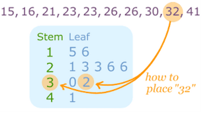

**Stage 8**

* Discrete data is data **not** grouped into class intervals → 1, 2, 3, 4, 5
* Continuous data is grouped into intervals → 1 ≤ x ≤ 5
* We have to use the modal class when calculating the mode for continuous data.
* Mean for continuous data is called the ‘estimated mean’.
* To calculate the estimated mean, we divide the sum of the frequency • mid point by the total frequency values.

* A stem-and-leaf diagram shows each class interval, along with different values in the class interval.
* A key is important while interpreting or creating a stem-and-leaf diagram.

* Analysis of a line graph can be done by drawing a line connecting the x-value to its y-value. That will give us the answer.