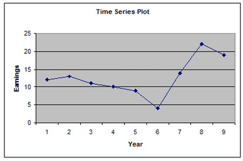
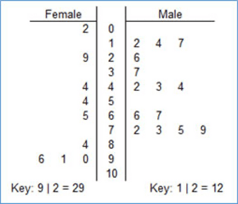

**STAGE 9**

* Frequency diagrams for continuous data have class intervals instead of single-class values. 
* A line graph for time series is a line graph with values taken over regular time intervals. 

 

* Scatter plots are diagrams that use dots to indicate values for data points. 
* Scatter plots are interpreted the same way as line graphs. 
* A back-to-back stem-and-leaf diagram portrays values with similar stems in a more organized manner. 
* Each set of leaves in this diagram has a different key.

 

