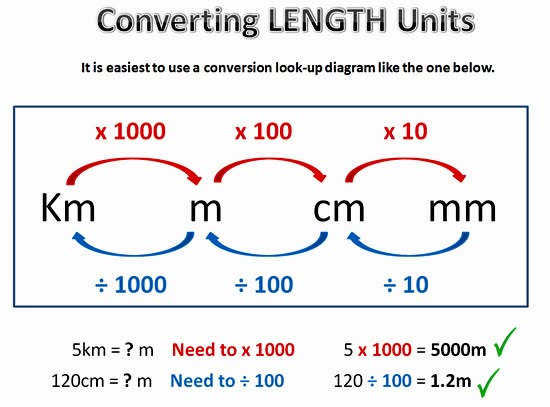

# Length, Mass and Capacity

## Length

Length helps us to measure **how long something is** (from one point to another point). The units of length always end in “**meters**”.

* The common units of length include: millimeters *(mm)*, centimeters *(cm)*, meters *(m)*, and kilometers *(km)*.

  **Examples**

* Millimeters are used to measure small items, such as paper clips.

* Centimeters can be used to measure objects which we use in our daily life, such as rulers or books.

* Meters are commonly used to measure height.

* Kilometers are used to measure long distances travelled.

  