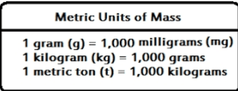

## Mass

Mass is commonly used to measure **the weight of an object**. The units of mass always end in ‘**grams**’.

There are three common units: grams, kilograms, and tonnes.

**Examples**

* Grams (g) are used to measure light objects, such as a book or a laptop.
* Kilograms (kg) are used to measure relatively heavy objects, such as rice.
* Tonnes (t) are used to measure heavy objects, such as cars or airplanes.
  