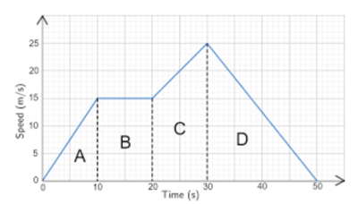

## Travel Graphs

Travel graphs help us to analyse the ratio between distance travelled against the time needed. It is interpreted using a line graph:

Speed is **inversely proportional** to time for a constant distance.

The x-axis represents the time, while the y-axis represents the speed.

* The point where two values meet on the graph represents the distance travelled by multiplying the time with the speed.

  Distance = Speed x Time