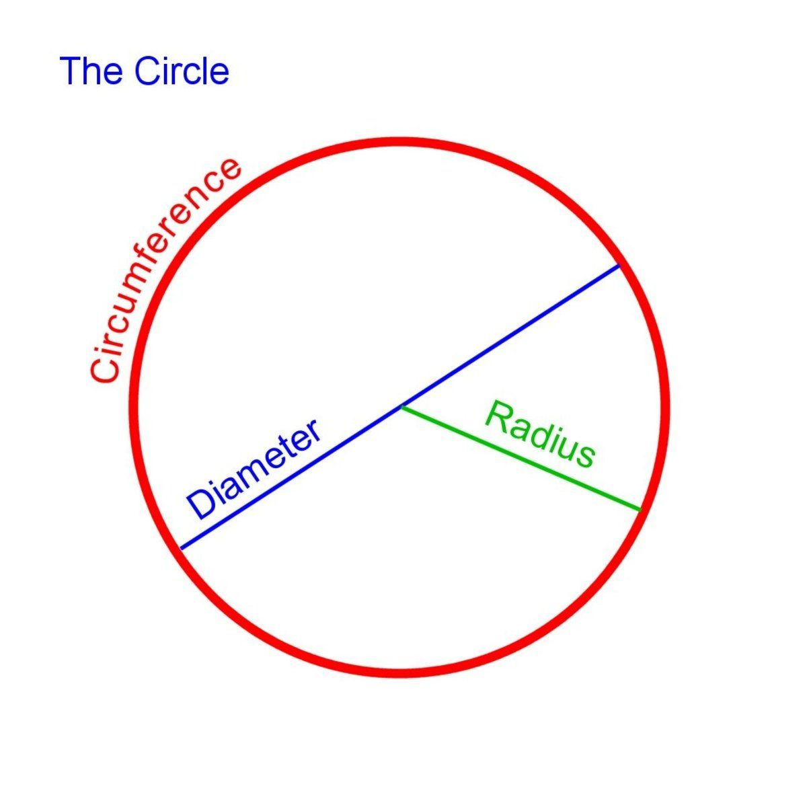

# Area and Perimeter

## Perimeter

Perimeter refers to the total measure of sides in a 2- dimensional shape.

**Perimeter of:**

* Squares, rectangles, trapezoids, parallelograms and triangles: Add the measures of all the sides.
* Circles = 2𝜋r or 𝜋d, where **r is the radius** and **d is the diameter** of the circle. Perimeter of a circle is called “**circumference**”.

Example Questions:

1. Find the perimeter of a square with sides 4 cm.

   
   Solution:

Square has 4 sides, 4cm/side

4 + 4 + 4 + 4 =16cm

2. Find the circumference if a circle, which has a radius of 5 cm. Give your answer in terms of 𝜋.

Solution:

2𝜋𝑟 = 2 x 𝜋 x 5=10𝜋 cm.