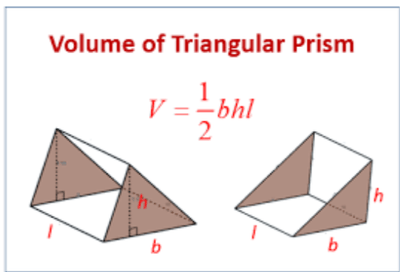
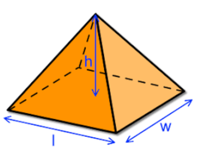
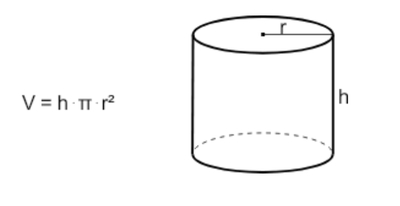

## Volume

Volume is the amount of space covered by a 3-dimensional object.

Important Formulae:

* Cube and cuboid = Length x Width x Height
* Sphere =$\frac{4}{3}$ $𝜋r^3$
* Triangular Prism = $\frac{1}{2}$ x width x length x height

* Pyramid = $\frac{lwh}{3}$

  

* Cylinder: Base area x Height

