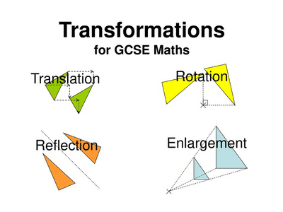

## Coordinate System

The coordinate system refers to the cartesian coordinates.

The horizontal axis is the x-axis while the vertical axis is the y-axis. Both axes have equally spaced points.

* Distance can be measured by calculating how far a point has travelled.

* To measure the midpoint of a line, it is calculated by:  ( $ \frac{x_1 + x_2}{2} $, $\frac{y_1 + y_2}{2}) $  where $$x_1$$ and $$y_1$$ are the coordinates of the starting point, and $$x_2$$ and $$y_2$$ are the coordinates of the ending point.

  ### Transformations

* Transforming, translating and rotating an image will preserve it’s angle values, using the concept of similarity.

* Translating an image will move it to the left/right/top/bottom by a given factor.

* Rotating an image will rotate it by a given angle value.

* Transforming an image will move it to a given quadrant, where the x- and y-coordinates are determined by the quadrant.

* Locus points are all possible points from a given distance from a fixed point of line.

