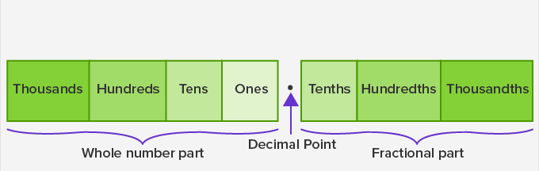

# Place Values, Ordering and Pounding

## Place Value

* Like whole numbers, decimals also have place values
* The decimal place values:

* Notice that the more right we go, the more we divide the place values by 10
* Similarly, we divide by ten the more right we go in decimals.
* The decimals for place values are similar to the normal place values, except we add a ‘ths’ at the end.

E.g. ten**ths**, hundred**ths**, thousand**ths**…

* When we multiply decimals by 10, 100, or 1000, we shift the decimal point to the right by 1 digit, 2 digits, and 3 digits, respectively.

E.g.

1\.5 x 10 = 15.0 = 15

1\.567 x 100 = 156.7

1\.90389 x 1000 = 1903.89

* We use the same method for division, except that we move the decimal point to the left by 1 digit, 2 digits, and 3 digits, respectively.

E.g.

1\.567 ÷ 10 = 0.1567

134\.5678 ÷ 100 = 1.345678

0\.12345 ÷ 1000 = 0.00012345

* We can get decimals through negative powers as well. For example,

$10^{-1}$  = 0.1,

$10^{-2}$ = 0.01,

$10^{-4}$ = 0.0001…

Negative powers of 10 give decimals, where the power tells you how many places to move the decimal point to the left.