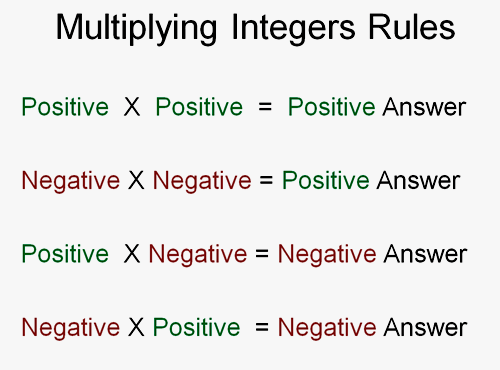

# Integers, Powers and Roots

## Integers

* Integers are whole numbers, which can be positive or negative in value.
* Integers do not have a fractional component, i.e. they are whole numbers
* The range of values of an integer is a whole number from negative infinity to infinity, including zero (0).
* Integers can be added, subtracted, multiplied or divided.
* Integers have to be rational, i.e. they cannot be numbers like √2 or √3
* Rules for multiplying negative numbers:

