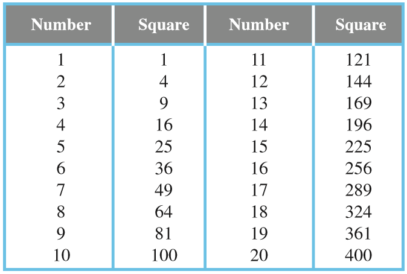

## Powers

* Powers are also known as exponents.

* Powers of a number says how many times we have to multiply the number by itself over again.

E.g.

$2^{2}$ = 2 x 2 = 4

$3^{4}$ = 3 x 3 x 3 x 3 = 81

* Powers are written by using a superscript, which is a smaller version of a number written on top of another number, like written above.

* In  $2^{5}$, 5 is the exponent, and the number 2 is called the coefficient.

* There are a few rules of doing operations with exponents:

1. $a^{m^{n}} = a^{(mn)}$
2. $a^{m} ÷ a^{n} = a^{m-n}$
3. $a^{m} x a^{n} = a^{(m+n)}$
4. $\frac{a^m}{b^m} =  {(a ÷ b)}^m$
5. $a^m x b^m = {(ab)}^m$
6. $a^0 = 1$

E.g.

$9^{0}$ = 1,

$100^{0}$ = 1,

$45.78^{0}$ =1 etc

Squares up to 20:

