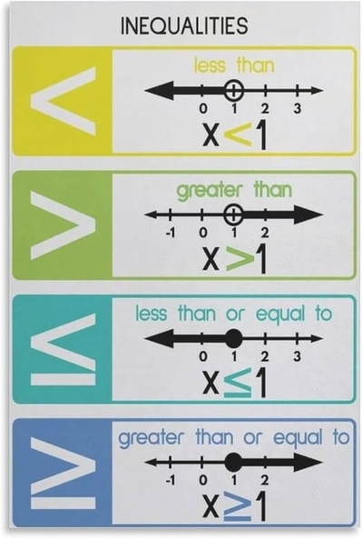

## Equations

* Equations are two or more expressions, equated using the symbol ‘=’ which means ‘is equal to’
* An equation usually has an expression on either side of the ‘=’ symbol.
* Whenever we perform any action to one side of the equation, we must also perform it to the other side to keep the equation balanced.
* Simultaneous equations are two or more equations which have the same solutions. We can perform operations on simultaneous equations to solve them.

E.g.

$2x+8y=12$  ---  Multiply by 3

$3x+4y=10$  --- Multiply by 2

$6x+24y=36$

$-(6x+8y=20)$

$16y=16$1

So $y=1$

* We can substitute the value of *$y$* into the equation. $4y$ means 4 times *$y$*, which is 4x1 = 4

So we can then write $3x+4=10$

So, $3x=6$

We can get that *$x=2$*

* Inequalities can be written using the symbols <, >, ≤ and ≥.

* A solution set can be written by the use of a number line.

