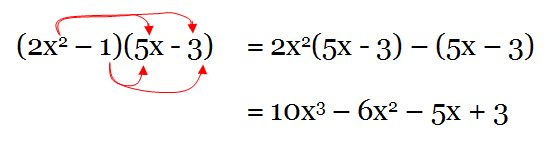

## Formulae

* A formula is a mathematical rule expressed in algebraic symbols.
* We can substitute values into formulae to be able to solve an equation.

E.g. If the formula to find y is $25-x$, we can take the value of x as 1,2,3 and so on to be able to find the value of y.

* The plural of ‘formula’ is ‘formulae’.

* A function is a relationship between two or more variables. A

* Changing the subject in an equation means changing the equation in a way that we get a required variable on one side of the equation.

E.g. $y=\frac{k}{x}$

And we want to make this in terms of x

Multiply both equations by x and divide by y

So we can get $x=\frac{k}{y}$

* The quadratic equation comes in the form of

*$ax^2+bx+c$*

where a, b, and c are known, while x is unknown,

and a is not equal to 0, and the highest power/degree is of 2.

* We can simplify quadratic equations.

* Likewise, we can also expand quadratic equations.

