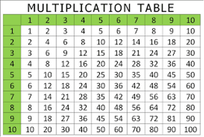
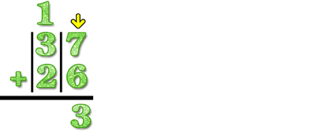
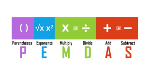
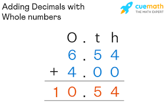
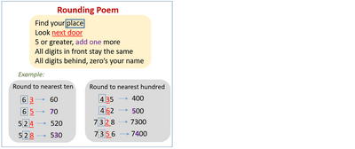

# Calculation

## Stage 7

* Calculating mentally is one of the most fundamental skills in mathematics
* Multiplication is also known as repetitive addition. In the expression 3 x 5, we add 3 together 5 times.

* Even numbers are divisible by 2.
* Odd numbers give a remainder of 1 when divided by 2
* The right-most digit of a number is it’s ones digit, the next number its tens, the next its hundreds and so on
* We multiply by 10 while going to the right when dealing with decimal place values.
* To multiply a 2-digit number by a 1 digit number, simply multiply the one-digit number with both digits of the 2-digit number, and insert both values side by side.

E.g. 30 x 6 ==> 0 x 6 = 0

3 x 6 = 18

so 30x6 = 180

* Carryovers are numbers that we carry above the next place values’ place and add them to the product/sum we get.

* Divisibility tests are an easy way to test whether a number is divisible by another number.

|Number|Divisibility Test|Example|
|:---|:---|:---|
|2|The number should end with 0, 2, 4, 6, or 8|20, 32, 50, 1430|
|3|The sum of the digits should be divisible by 3.|180, 60, 33, 42, 981|
|4|The last 2 digits of the number should be divisible by 4.|16, 20, 24, 80|
|5|The number should end in 0 or 5.|50, 30, 20, 105, 155|
|6|The number should be even and divisible by both 2 and 3.|36, 48, 600|
|8|The last three digits of the number must be divisible by 98|16, 80, 120|
|9|The sum of the digits of the number must be divisible by 9.|18, 108, 135|
|10|The number must end in at least one 0.|10, 20, 30, 1890|
|100|The number must end in at least two 0s.|100, 200, 300, 500|

* To multiply one-digit numbers with simple decimals, multiply the numbers without the decimal point, and then divide it by the number of zeroes in the decimal.

E.g. 6 x 0.8 ==> 6 x 8 = 48

48/10 = 4.8

* To multiply fractions with whole numbers, multiply the numerator by the given value, and then divide this product by the denominator

E.g. 64 x 2/4 ==> 64 x 2 = 128

128/4 = 32

* The order of operations is PEMDAS, and the order must be followed at all times.

* Adding or subtracting decimals with different decimal places can be accomplished by writing them vertically.

* Dividing and multiplying decimals by single-digit numbers require rounding up/down based on given decimal value.
* Round up only if the value is more than or equal to 5, and round down otherwise.

* To multiply or divide decimals, we must first find the number of decimal places. Once the operations is/are completed, we round the answer to the given number of decimal places.