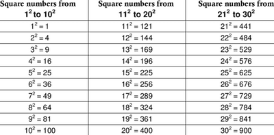
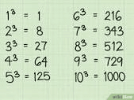

## Stage 8

* **Square numbers** are numbers which result from multiplying a number by itself twice.
* Square numbers are often written in an exponent

* **Cube numbers** are numbers resulting from the multiplication of a number by itself 3 times.

* **Roots** are the numbers that are multiplied together to get another number.
* Fractions can be converted into decimals and percentages.

==> $\frac{1}{2} $= 50% = 0.5

==> $\frac{2}{10}$ = 20% = 0.2

* Multiplying fractions requires us to multiply the numerators together and the denominators together.
* Dividing fractions will require us to convert to multiplication, by converting the second fraction into its reciprocal.

* Multiplying and dividing decimals requires the use of place values.

E.g. 2.4 x 3

=24 x $\frac{3}{10}$

= 7.2 (place value: tenth)

* To calculate simple fractions and percentages of quantities, we have to multiply the numerator by the given quantity and then divide it by the denominator.
* Units of measurement are used to measure different quantities.

Meter = S.I. Unit

**Kilo**meter = 1000m

**Centi**meter = 1/100m

**Milli**meter = 1/1000m

* Direct proportion can be written in the form of $y = kx$, where k is a constant.

==> If 2 eggs are used to make 1 pie, how many eggs are needed for 10 pies?

1 pie = 2

10 pies = 2 x 10 = 20 eggs

* The order of operations must be strictly followed at all times.

==> $\frac{6}{2}$(1+2)

= $\frac{6}{2}$x(3)

= $\frac{6}{6}$

= 1

* Dividing integers and decimals will require the use of a decimal point, where the divisor is multiplied by 10 and the division resumes.