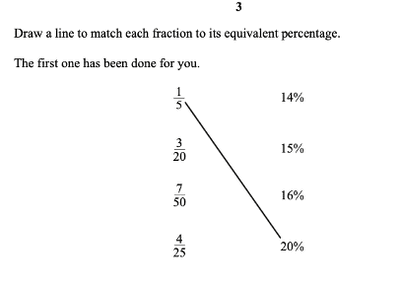
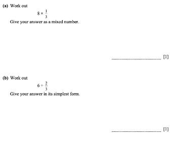
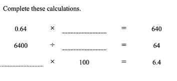

## Checkpoint Past Papers

Q1.   

**Solution:**

1. Convert ALL values into denominators of 100, and then to percentages.

$\frac{1}{5}$ **→** $\frac{20}{100}$ **→ 20%**

$\frac{3}{20}$ **→** $\frac{15}{100}$ **→ 15%**

$\frac{4}{25}$ **→** $\frac{16}{100}$ **→ 16%**

2. Match these values with their respective percentages.

Q2.   

**Solution**:

(a)

1. Multiply the numerator with the integer.

8 x $\frac{1}{3}$ = $\frac{8}{3}$

2. Now, divide 8 by 3 ==> $2\frac{2}{3}$

(b)

1. Take the reciprocal of the divisor and write the statement ==> 6x$\frac{3}{2}$

2. Multiply 6 with 3, which is equal to 18.

3. Divide 18 by 2, which is 9

Q3.   

Solution:

* The concept is to understand that the number of digits behind the decimal place is the number of zeroes in the exponent of 10.

a) To get 640, we move the decimal place **right** by 3 → 1000

b) To get 64, we move the decimal place **left** by 2 → 100

c) Divide 6.4 by 100 and we get → 0.064