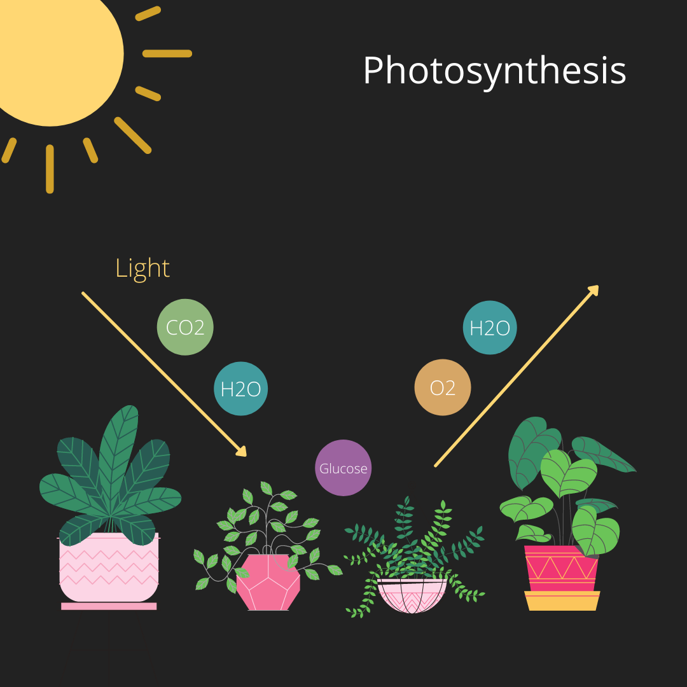

## Characteristics of Plants

* Plants *move* as they *grow* and spread out over the ground.
* Plants *respire,* and gaseous exchange happens through leaves.
* Green plants are *sensitive* towards light and grow towards it.
* Plants *reproduce* by making seeds or spores, and some make copies of themselves - plantlets.
* *Waste* may be stored in leaves.
* Plants make *food* from carbon dioxide and water.

 