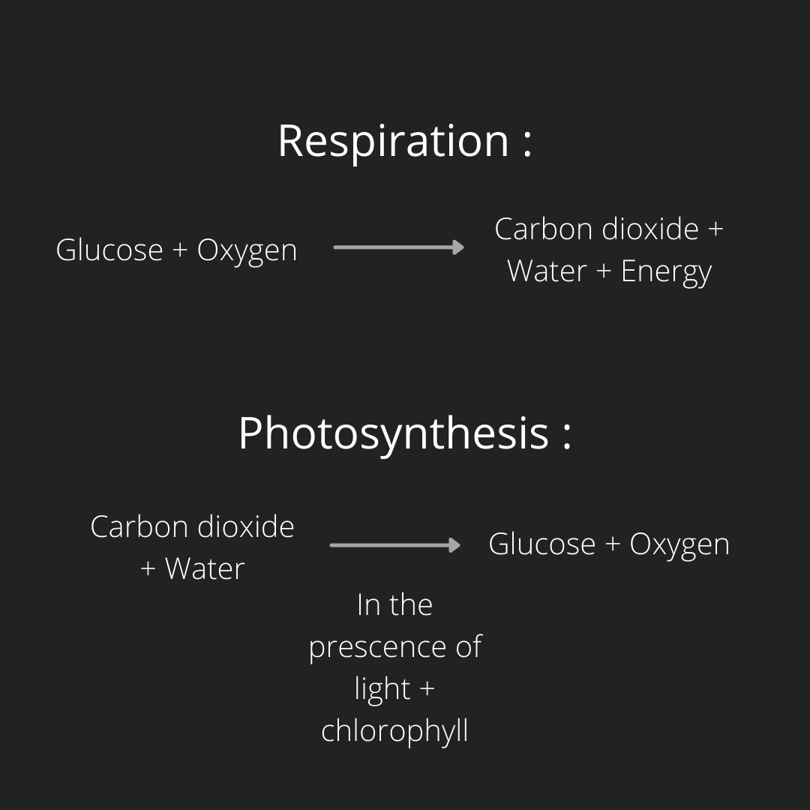

## Respiration

* A process where food is converted to energy.
* It is a chemical reaction within our bodies.
* Glucose reacts with oxygen to release energy, carbon dioxide and water.
* Breathing is inhaling and exhaling - moving air in and out of our bodies.

  Respiration should NOT be confused with this.
* Plants *photosynthesise* to produce food, and they also *respire*.

  \
   

