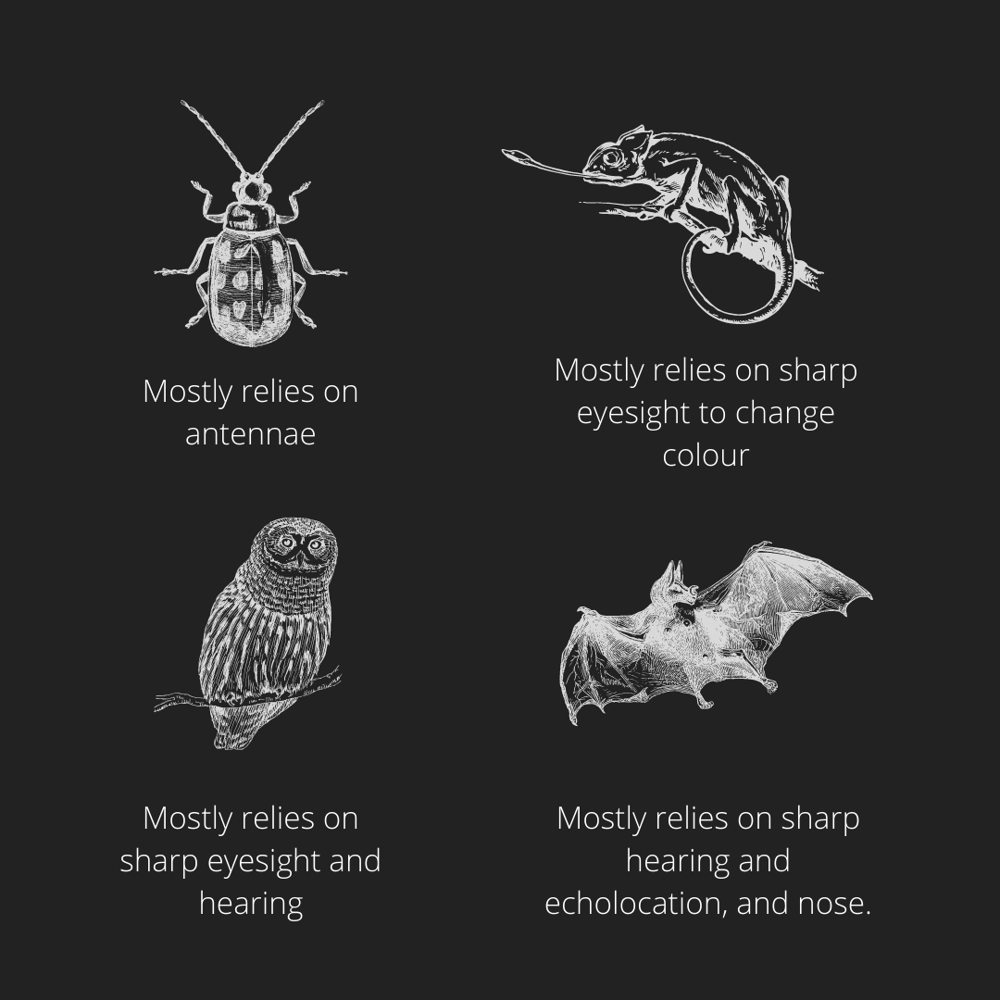

## Sensitivity

* Animals detect changes with their sense organs.
* Skin (feel), Eyes (see), Ears (listen), Tongue (taste), and Nose (smell).
* Insects have long *antennae* - which they use to touch the ground in front of them, to decide if it is safe to move or not.

 