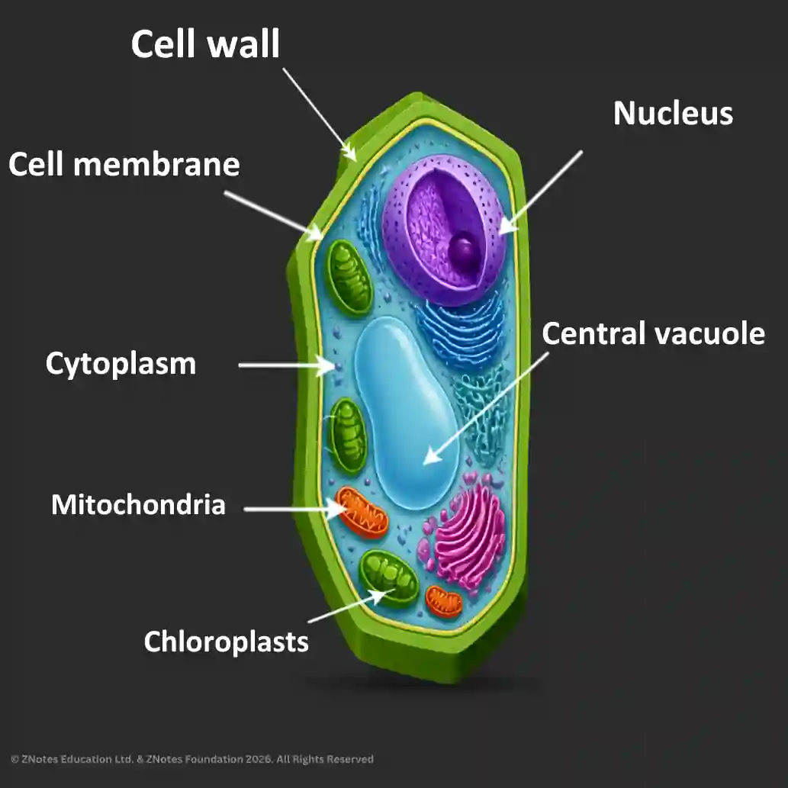

## Plant cell

Note: Plant cells also have the same parts in an animal cell, and they work in a similar fashion. Apart from this, plant cells have few other parts as well.

### Cell wall

* Found outside the cell membrane.
* Made of **cellulose**- a tough material that gives support to the cell's structure.

### Chloroplast

* Found in the cytoplasm in leaf cells and stem cells of some plants.
* Contains a green pigment called **chlorophyll** - which traps energy from the sunlight.
* Chlorophyll helps make food for the plants through **photosynthesis**.

### Large vacuole

* The large space in the cytoplasm of a plant cell.
* Filled with a liquid called **cell sap**.
* When the vacuole is full of cell sap, the liquid *pushes outward* on the cell wall, giving it support.
* If the plant doesn't have enough water, the support is lost, and it wilts.

