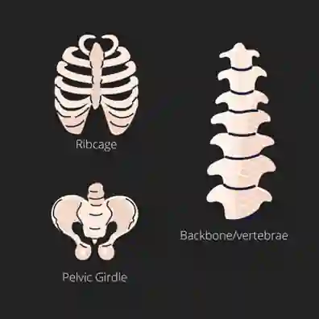
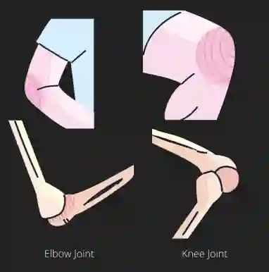

## Skeletal System

* There are 206 bones in the human skeleton.

* Together, each arm and hand have 30 bones. Together, each leg and foot have 29 bones.

* The skeleton accounts for 15% of the body's mass.

* The tissue of the skeleton (bone) is hardened as it takes calcium from digested food.

### **Protection**

* The brain and spinal cord form the CNS (Central Nervous System) and are made from soft tissue.

* They can be damaged without a hard covering.

* The skull bones are fused to make a strong barrier around the brain.

* The backbone comprises 33 bones known as vertebrae (singular: vertebra).

* There's a hole in each vertebra through which the spinal cord runs.

* The column of Vertebrae makes a tube of bone around the spinal cord.

* There are gaps between the vertebrae through which nerves pass from the spinal cord to the body.

* The ribs and backbone form a protective structure around the lungs and heart.

* The ribs aren't heavy to allow for the movements of the heart.

### Support

* The organs form systems (digestive, circulatory, excretory, and respiratory) that account for 20% of the body's weight.

* The organs are made from soft material and have no supporting material inside them.

* The skeleton's bones provide a solid structure to which the organs are attached.

* They allow the organs to be spread out in the body without squashing into each other.

### Movement

**Joint** - the place where bones meet.

* In some joints (skull), the bones are fused and cannot move.

* Most joints allow some movement.

* Joints at the elbow or knee are called **hinge joints** - as they move like the hinge on a door. They can only move back and forth.

* Joints at the hip and shoulder are called **ball-and-socket joints** the end of the bone forms a round structure like a ball that fits into a cup-shaped socket. These allow more movement.

**Ligament** - fibres that prevent the bones from coming apart.

**Cartilage** - a hard, slippery surface that prevents bones from wearing out when they rub against each other. Reduces friction and allows ease of movement.

**Synovial Fluid** - a liquid in joints that requires a lot of movement (knees). It spreads out over the surface of the cartilage and acts like oil. Reduces friction and wear.