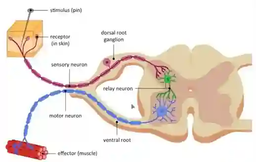

## Nervous System

* Comprises of the **brain , spinal cord , and nerves**. 

* The brain is enclosed in the skull. 

* The spinal cord is enclosed in the backbone. 

* Nerves connect the brain to the eyes, ears, tongue, nose, skin, and to all the other organs in your body. 

* Messages travel through the nervous system in tiny electrical signals (called **impulses** ). 

* The sense organs send signals to the spinal cord and the brain. 

* The brain can also send signals to your muscles - to move so you can walk, dance, raise your hand, nod etc.

## Reflex arc 

* Receptor: Specialised cells (e.g., in the skin) that detect a stimulus such as pain, pressure, or temperature. 

* Sensory Neuron: Transmits the electrical impulse from the receptor toward the central nervous system (CNS), specifically the spinal cord. 

* Relay Neuron: connects the sensory neuron to the motor neuron. 

* Motor Neurone: Carries the impulse away from the CNS to the target organ. 

* Effector: A muscle or gland that carries out the response, such as contracting to pull a hand away from a pin

