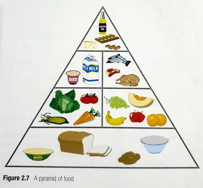

# Healthy Diet

## Nutrients

* Chemicals needed by the body to keep it in good health are called nutrients.
* The human body needs a large number of nutrients to keep it healthy.
* In addition, the body also needs water. It accounts for 70% of the body’s weight.

 

