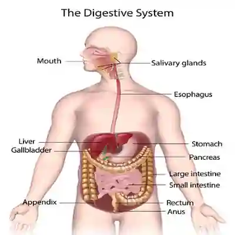

# **Digestive system**

**The alimentary canal** - is the central part of the digestive system. It is a tube that runs throughout the body. It includes the following:

* Mouth (digestion begins here)

* Throat (Pharynx)

* Oesophagus (food pipe)

* Stomach

* Intestines (Large and Small)

The alimentary canal is approximately 9 meters long and folds inside your abdomen to fit in there.

It takes between 24 and 48 hours for the food to travel through the alimentary canal completely.

### **Process of mechanical and chemical digestion**

* Your teeth break down the food into small chunks.

* Saliva in the mouth breaks the chunks into smaller molecules.

* The saliva helps moisten the food (now called the **bolus**) - so they travel down the esophagus smoothly.

* In the stomach, acids help turn the bolus into a creamy liquid called **chyme**.

* The small intestines absorb nutrients in the food.

* The large intestines absorb water. This now then gets excreted after the whole process.