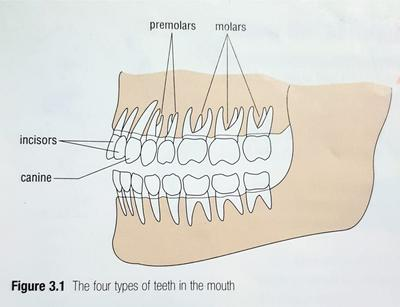

## Breakdown of food

### Physical breakdown

* **Incisors**- chisel shaped, used for biting down into soft foods (fruits)
* **Canines**- fang shaped, can tear into tougher foods (meat)
* **Premolars**, **Molars**- raised parts called cusps with grooves, used to grind and crush food at back of the mouth,
* We have 20 sets of milk teeth that emerge at 6 months and are fully formed by year 3 of life.
* They are replaced by 32 permanent teeth from age 7 to 17.

### Chemical breakdown

* Carbohydrates, fats and protein are large molecules that are made of chains of smaller molecules. They do not dissolve in water and cannot pass through the lining of our digestive system and into the blood stream.
* Digestive enzymes *catalyse* (speed up) the breakdown of larger molecules into smaller ones.

|Region of production|Type of enzyme|Notes|
|:---|:---|:---|
|Salivary glands in mouth|Carbohydrase|Enzyme is called salivary amylase|
|Gastric glands in stomach|Protease|Enzyme is called pepsin \\n Hydrochloric acid is used to make the enzyme work|
|Pancreas|Protease, Carbohydrase, Lipase|Enzymes enter the duodenum and mix with food and bile.|
