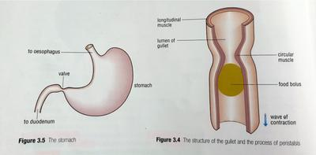

## Chewing and swallowing

* Saliva is made up by 3 pairs of salivary glands which are made up by groups of cells, and salivary ducts (tubes) deliver it to the mouth.
* Saliva is 99% water and also contains a slimy substance called **mucin** and an enzyme called **amylase.**
* **Mucin** coats the food and makes it easy to swallow. Amylase begins the breakdown of starch molecules in the food into sugar molecules.
* Once you chew the food, it is made into a pellet called the bolus. It is pushed to the back of the mouth by the tongue.
* Swallowing causes the bolus to slide down your gullet (food pipe / oesophagus)
* The oesophagus has an outer longitudinal muscle layer and an inner circular muscle layer.
* Circular muscles on the top of the gullet contract and push food along the tube.
* Longitudinal muscles contract to stretch the circular muscles once again.
* The wave of muscular contraction is called **peristalsis**, you can feel the movement against your throat when you swallow.

 

