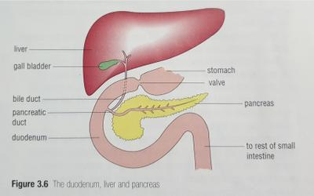
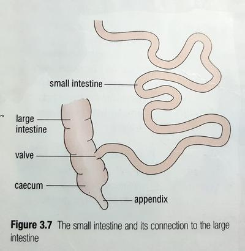

## Organs and their roles

### Stomach

* Glands lining the stomach wall produce hydrochloric acid and **pepsin** (protein digesting enzyme)
* HCl acid kills bacteria in the food and provides ideal acidic conditions for the enzyme pepsin to function optimally.
* Food is churned by the *peristaltic waves* created by the muscles at a rate of 3 per minute.
* Food is prevented from leaving the stomach by a valve - opens once food is digested into **chyme** (creamy liquid) and allows it to pass into the duodenum.

### Duodenum, liver and pancreas

* Duodenum is a part of the small intestine and is connected to the stomach.
* A green liquid called bile enters the duodenum via the bile duct from the gall bladder.
* Bile is made in the liver and contains chemicals that mechanically breakdown fat into smaller droplets. Allows lipase to break down the lipids faster, as there is higher surface area.
* Pancreatic juices enter the duodenum via the pancreatic duct from the pancreas.
* The juices contain a mix of chemicals that digest fat, carbohydrates and proteins.

 

### Small Intestine

* Cells lining the wall of the small intestine make enzymes that complete the digestion of carbohydrates and proteins.
* Small molecules are soluble and pass through the walls of the small intestine and into the blood stream, where they are sent to all the cells in the body.

| Large insoluble molecule | Small soluble molecule |
|----|----|
| Protein | Amino acid |
| Carbohydrates | Sugar |
| Fats | Fatty acids + glycerol |

 