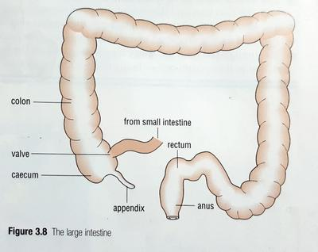

## Egestion

* Indigestible parts of the food, such as cellulose pass on through the small intestine to the large intestine and colon.
* First part of the large intestine is known as the **caecum**, the rest is the **colon**.
* Water and dissolved vitamins are absorbed into the body.
* Remaining semi-solid substance forms the faeces, which is stored in the later part of the large intestine known as the **rectum**.
* Faeces are removed from the body in a process called *egestion*/*defecation* through the **anus** once a day.

 

