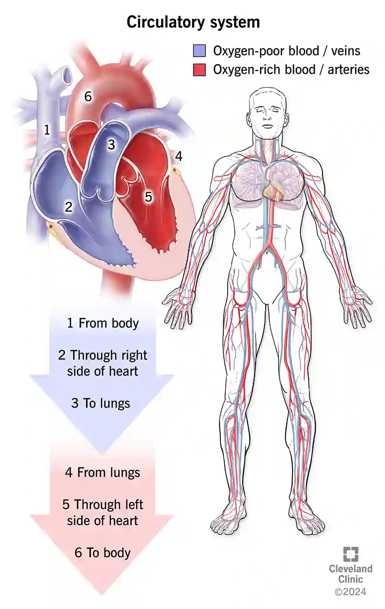

**The heart**

**Oxygenation of blood**

1. **Right** **atrium** receives *deoxygenated* blood from the body via the **vena cava**.

2. Blood enters the **right** **ventricle** via the **bicuspid** **valve**

3. Blood is pumped into the **lungs** through the **pulmonary** **artery**(only artery that carries deoxygenated blood)

4. Blood is oxygenated in the lungs, and enters the **left** **atrium** of the heart via the **pulmonaryvein** (only vein that carries oxygenated blood)

5. Blood flows into **left** **ventricle** via **tricuspid** **valve**

6. Heart pumps the blood with force to the **aorta** - which then sends the blood to all parts of the body.

**Functions**

* Valves prevent backflow of blood.

* Thick section of cardiac muscle called septum separate the left and right side of the heart.

* Muscles are the thickest around the left ventricle. When contracted, it increases the pressure of the oxygenated blood before it passes into the aorta.

