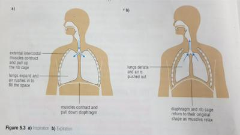

## Air pump

### Chest wall

* Made by ribs and their muscles.
* Each rib is attached to the backbone by a join that allows only small amount of movement.
* Muscles in-between the ribs are called the **internal** and **external intercostal muscles**, which cause movement of the ribs.

### Diaphragm

* Large sheet of muscle attached to the edges of the *tenth* pair of ribs and the backbone.
* Separates the chest cavity (contains the lungs and the heart) from the **lower** **body** **cavity** (stomach, intestines, liver, kidneys, female reproductive organs)

### Breathing movements

| Breathing movement | Inspiration | Exhalation |
|----|----|----|
| External intercostal muscles | Contract | Relax |
| Rib action | Move up | Move down |
| Diaphragm muscles | Contract | Relax |
| Diaphragm action | Moves down + flattens | Moves up + dome shaped |
| Chest volume | Increases | Decreases |
| Air | Moves in | Moves out |

 

### Depth of breathing

* Tidal volume - amount of air breathed in and out of rest (500 cm3 in humans)
* Vital capacity - maximum amount of air that can be breathed in and out (4000 cm3 in humans)

