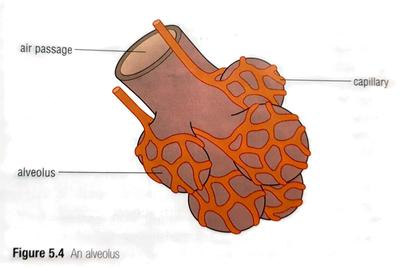
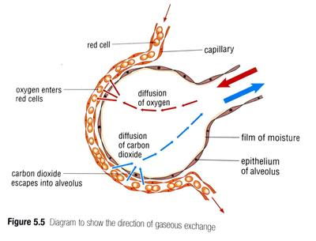

## Gaseous exchange

### Alveoli

* At the end of each bronchiole is a very short tube called the alveolar duct
* **Alveoli** open into this duct (bubble like structures)
* Each alveoli have a moist lining + thin wall + supplied with tiny blood vessels called **capillaries**.
* Forms the respiratory surface.
* Gaseous exchange takes place here.
* Spongy structure of lungs is produced by 300 million alveoli: increases surface area for gaseous exchange.

 

### How it works

1. Oxygen from inhaled air moves by *diffusion* through the walls of the alveolus and the capillary next to it.
2. Oxygen diffuses into the blood and enters the red blood cells, which contain a dark red substance called **haemoglobin.**
3. Oxygen binds with haemoglobin to make **oxyhaemoglobin**, which is bright red.
4. Oxygen can now be transported by the cell more easily to the parts of the body, after it has binded.
5. Carbon dioxide is dissolved in the watery part of the blood called **plasma**.
6. CO2 moves by diffusion through the capillary and alveolar walls.
7. Changes into a gas it leaves the moist lining of the alveolus.
8. CO2 is exhaled.
9. Blood moves through the capillaries very quickly, large amounts of oxygen and carbon dioxide can be exchanged in a short time.

 

