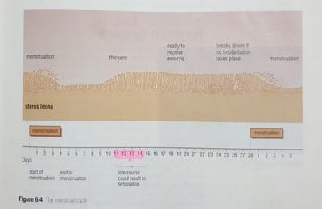

## Menstrual cycle

* From the beginning of puberty, the menstrual cycle occurs every month in females (approx.)
* It does not take place during pregnancy.
* It includes a period of bleeding from the vagina which may last for about 4 days.
* During this time an egg starts to mature in one of the ovaries. About 10-12 days after the bleeding ends, the egg is released from the ovary.
* Alternate ovaries release an egg each month.
* Egg is then moved down the fluid filled **oviduct** by movement of **cilia** in the oviduct walls.
* At the same time as the egg matures in the ovary, the **uterine wall** and its tissues thicken with blood.
* It does this to prepare to receive a newly formed **embryo** in case fertilisation takes place.
* The egg may survive for up to 2 days in the oviduct and fertilisation can take place during this short window.
* If egg isn’t fertilised, no further development of the egg takes place.
* After 12 days after the egg dies, the uterine wall breaks down and blood passes out of the vagina along with tissue fluid, and other waste substances.
* The length of the time of the period of bleeding differs between people, and so does the amount of blood released.
* Some may feel ill before their period starts, some may experience low to extreme cramps and abdominal pain during their period. Some are unaffected too.
* The menstrual cycle starts around puberty (10 -13) and continues every month until the beginning of menopause (which starts about the age of 45)
* During **menopause**, periods become irregular and eventually stop.
* Menopause may end when a woman is in her early 50s, and her body stops producing eggs each month.

 

