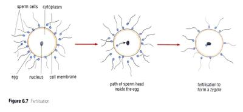

## Fertilisation

* When the sperm cells meet an egg in the oviduct, they crowd around it.
* The head of only one sperm cell penetrates the cell membrane of the egg.
* The sperm cell’s head breaks off from the tail and moves through the egg cell’s cytoplasm to the nucleus.
* When the head reaches the nucleus fertilisation takes place
* Nucleus of the sperm and nucleus of the egg fuse
* Fertilised egg is called a **zygote.**
* Changes to the cell membrane around the zygote prevent other sperm heads from entering and fusing with the nucleus.
* The **nuclei** of the sperm and egg contain **genetic code** (instructions) for the development of the baby.
* If the zygote becomes implanted into the uterine wall, it can develop into a baby.
* The period of time from fertilisation (**conception**) to the birth of the baby is known as **pregnancy.**

 

