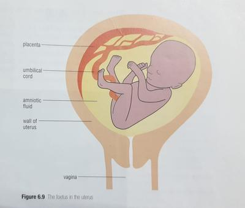
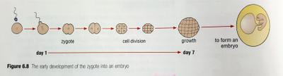

## Development of the baby

### Implantation

* After fertilisation the zygote divides into two cells, then 4, then 8 and so on
* The zygote does not increase in size in the first seven days, so cells become smaller each division.
* By the 7th day, the cells have formed a hollow ball and have reached the uterus.
* The ball sinks into the thick lining of the uterus, which has a large amount of blood passing through it’s tissues.
* This process is called **implantation**, and now the zygote will develop into an **embryo.**

### Placenta

* The cells on the surface of the hollow ball of cells of the zygote will form the placenta.
* This takes in food and oxygen from the mother’s blood so that cells can grow and divide.
* Waste products such as $CO_2$ from cell’s activities pass across the placenta to the mother’s blood, so she can remove them through her own lungs or kidney.
* During pregnancy the placenta grows into a disc with a diameter of about 20 cm.
* It forms microscopic finger like projections called villi that penetrate into the uterus wall and make a very large surface area for the exchange of material between the baby and the mother.
* The placenta is attached to the developing baby by the umbilical cord.
* Blood runs through vessels in the cord between the placenta and the baby’s tissues.
* The baby’s blood and the mother’s blood always remain separate.
* This is because the mother’s blood is at a much higher pressure than the baby’s, so it would damage the baby’s blood vessels if it passed directly.
* Also, the two blood groups may not be the same - if they mixed up, clotting would occur which would block the blood vessels and lead to further damage.
* Placenta makes hormones that stop the ovaries from producing more egg, which in turn stops the uterus wall from breaking down as it would do in a normal menstrual cycle.
* Antibodies pass from the mothers blood through the placenta to her baby to give protection from diseases.

### Amnion and its fluid

* During the development of the foetus a bag forms around it called the amniotic sac.
* This contains watery fluid.
* The fluid acts like a cushion around the foetus and protects it form pressures outside the uterus that might squash it.
* The fluid also allows the foetus to float freely so that the growing limbs have space to develop and are not pressed against the wall of the uterus; where the growth would be restricted.

### Embryo and foetus

* Although most people refer to a baby growing in the uterus, embryo and foetus is most used in the early stage.
* Most cells in the hollow ball form the embryo.

|Time period|Foetus size|Development|
|:---|:---|:---|
|2 weeks|\>2 cm|Flat disc of tissue|
|4 weeks|\> 2cm|Simple body shape with stumps where the limbs would grow|
|8 weeks|2.5 cm|All organ systems have been formed|
|14 weeks||Sex of the foetus can be revealed by an ultrasound scan|
|16 weeks|10 cm|Makes movements that the mother can feel|
|20 weeks|12.5 cm|Legs grow quickly|
|28 weeks||Turns upside down with head towards cervix \\n Alveoli in it’s lungs begin to grow, and continue to grow after birth|
|38 weeks|50 cm|Has a mass of about 3kg, ready to be born|

* In medicine the gestational period is referred to as 40 weeks rather than 38, because the time is calculated from the first day of the last period.

**Keeping a fetus healthy**

#|
||

What the mother should do

|

Why it is important

||
||

Eat a balanced diet

|

Provides nutrients needed for growth and development.

||
||

Avoid smoking

|

Nicotine reduces blood flow, and carbon monoxide reduces oxygen supply to the fetus.

||
||

Avoid alcohol

|

Alcohol can harm fetal development and cause lifelong problems.

||
||

Avoid illegal drugs and medicines not approved by a healthcare professional

|

Some substances can interfere with fetal development.

||
||

Attend antenatal appointments

|

Helps monitor the health of the mother and fetus.

||
||

Avoid infections and seek medical advice when unwell

|

Some infections can harm the developing fetus.

||
|#

