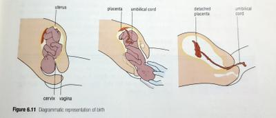

## Birth

### Stage 1

* Muscles in the uterus wall begin to contract, pushing against the pelvic bones and causing it to widen.
* Time between each **contraction** may be up to 30 minutes at first.
* During 12 to 14 hours in this stage the time between contractions shorten to 2-3 mins.
* At some point the contractions cause the **amnion** to break and the fluid to pass through the **vagina**.
* This is called “*breaking* *of* *the* *waters*”
* At the end of this stage the **cervix** has widened enough to allow the passage of the head of the **foetus**.

### Stage 2

* The mother contracts her abdominal muscles with the contraction of the uterus to push the foetus down the **birth** **canal.**
* This may last a few minutes and is completed when the baby has been birthed.
* **Umbilical** cord is cut and clamped to prevent loss of blood.
* If there are twins the contractions stop for about 10 minutes after the first baby has been born and then start again.
* The first two stages are called **labour**.

### Stage 3

* Lasts for about 20 minutes after the 2nd.
* During this time the placenta comes away from the wall of the uterus and passes down the vagina.
* When it has left the mother, the placenta is called the **afterbirth**.

 

