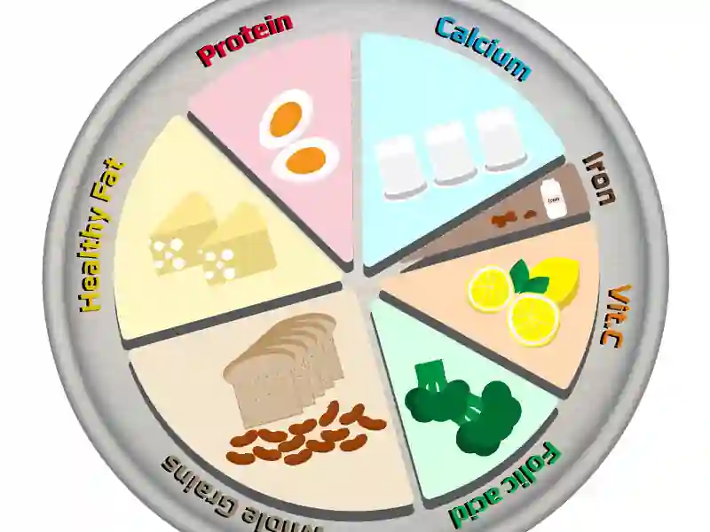

# Diet, Drugs and Disease

## Diet

Balanced diet: A diet consisting of a variety of different types that provides all essential nutrients (macronutrients & micronutrients) in adequate amounts for proper function of the body and energy.

**Nutrients**

* Chemicals needed by the body to keep it in good health are called nutrients.

* The human body needs a large number of nutrients to keep it healthy.

* In addition, the body also needs water. It accounts for 70% of the body’s weight.

#|
||

Nutrient

|

Function

|

Deficiency

||
||

Protein

|

Builds and repairs body tissues, makes muscles, and supports the immune system

|

Causes slow growth in children, muscle loss, swelling, and a weak immune system, also known as Kwashiorkor

||
||

Carbohydrates (Carbs)

|

Provides energy quickly for daily activities

|

Causes low energy, constant tiredness, dizziness, and muscle weakness

||
||

Fats and Oils

|

Provides long-term stored energy, keeps the body warm, and protects organs

|

Causes lack of essential fatty acids

||
||

Water

|

Helps control body temperature, carries nutrients, and flushes out waste

|

Causes dehydration, dry mouth, extreme thirst, headaches, and dark urine

||
||

Calcium

|

Builds strong bones and teeth, and helps muscles and nerves work

|

Causes weak bones

||
||

Iron

|

Makes hemoglobin

|

Causes Anemia

||
||

Vitamin A

|

Important for eye health

|

Causes night blindness

||
||

Vitamin C

|

Keeps skin, blood vessels, and bones healthy, and helps heal wounds

|

Causes scurvy

||
||

Vitamin D

|

Helps the body absorb calcium to build strong bones

|

Causes soft, weak bone in children (rickets)

||
|#

**Diseases**:

### Marasmus

* Lack of a healthy diet causes bodies to develop and grow slower and weaker than normal.
* Marasmus is a form of protein energy **malnutrition**.
* Occurs commonly in young kids living in famine/poverty.
* This condition results from a *lack* of **protein** and **carbohydrate** in the diet.
* To keep the body alive, all energy stores in the body are used up.
* Body fat disappears and the muscles start wasting away.
* Condition is fatal if not treated in early stages.

### Kwashiorkor

* Form of **protein** **malnutrition**.
* Condition that develops in kids over *eighteen* months.
* Occurs when mother feeds her baby breast milk, but when she has a second child the first child is given starchy food such as yam instead of milk. These foods have little protein.
* Causes poor development of muscles.
* Swelling of the stomach is seen as their diet consists of more carbohydrates.

### Obesity

* Condition that develops in children/adults who have a very high energy diet (eg. sweets, chocolate, pizza, foods with high carbohydrate and fat content)
* Energy is stored in the body as fat, and causes increase in body mass and slowing down of movement.
* As the person uses less energy than before but keeps eating the high energy diet, more body fat is produced.
* This puts extra strain on the bones and joints.
* Also affects working of the heart as there is too much cholesterol in the blood (refer notes under Circulatory System - Healthy Heart)
* Can lead to type 2 diabetes, affects the way the body controls amount of digested sugar in the blood.
* Normally the body produces insulin which helps the body take up extra sugar out of the blood and store it in the liver. In type 2 diabetes, the body no longer responds to insulin and blood with high sugar content flows around the body.
* This can eventually cause blindness, and damage to the nerves and blood vessels in the feet, which can only be treated by amputation.
* Can also cause kidney damage (fatal)

### Behaviour

* People who lack food may feel tired and have little energy to move around.
* People suffering from obesity/malnutrition may have low self-confidence, depressive feelings, and poor sleep routines.
* Hyperactivity in young kids can be caused by taking in foods with chemical additives that cause this.