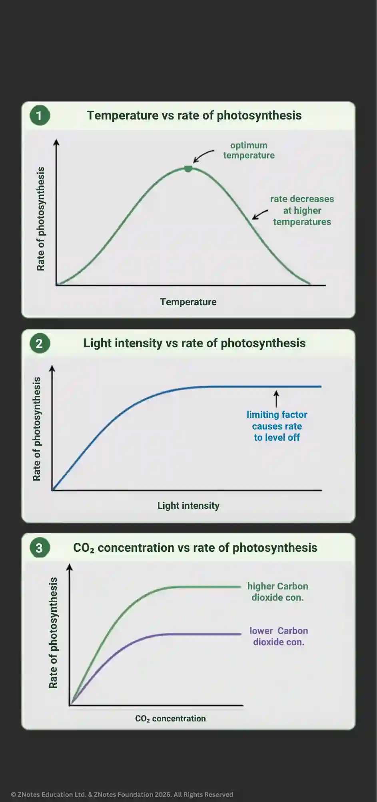

## **Photosynthesis**

It is the process by which plants use light and carbon dioxide to produce glucose for cellular respiration.

* **Word equation:**

  * $\text{Carbon Dioxide} + \text{Water} \xrightarrow{\text{light, chlorophyll}} \text{Glucose} + \text{Oxygen}$.

* **Chemical equation:**

  * $CO_2 + H_2O \rightarrow  C_6H_{12}O_6 + O_2$

* Glucose is then broken down in cellular respiration to release energy for active growth.

* Some glucose is converted to cellulose for cell wall construction and proteins/lipids for new cells.

* Some glucose is also stored in the form of insoluble starch.

## Conditions for photosynthesis

How effectively a plant can photosynthesize depends on 3 factors:

* **Light intensity:**  rate of photosynthesis increases as light intensity increases.

* **Temperature:** optimum temperature is needed for maximum photosynthesis.

* **Carbon dioxide concentration:** at higher concentration of carbon dioxide, the rate of photosynthesis increases.

* When one factor increases, the rate of photosynthesis increases until another factor becomes limiting.

The graph below shows how change in each factor affects the rate of photosynthesis.

