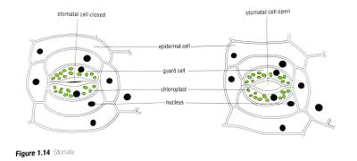

## Role of the leaf

### Structure

* **Epidermis**- upper and lower layer of the leaf, one cell thick.
* Outer surface of epidermal cells has a layer of wax which prevents water passing in/out of the leaf.
* **Palisade tissue**- layer of palisade cells found below upper epidermis, involved in making food.
* **Spongy Mesophyll tissue**- layer of cells below palisade layer, make food and also provide a surface for evaporation of water.
* **Vascular bundle**- contains xylem tissue (carries water and minerals) and phloem tissue (carries amino acids and sucrose)

### Leaves and water

* When water evaporates from cells in the **spongy mesophyll layer**, water vapour forms.
* If there is less water vapour outside than inside the leaf, water vapour diffuses out through the *stomata.*
* This makes the spongy mesophyll cells short of water, so they take more from the xylem tissue in the veins.
* The water lost in the veins is replaced by water passing up the xylem in the stem and root.
* **Transpiration**- process by which plants lose water from the stomata in the leaves.
* **Transpiration stream**- movement of water from the roots through the stem due to loss of water in the leaves

### Testing for transpiration

1. Place a plastic bag around the shoot of a pot plant.
2. Wait for a day, and test the liquid collected inside the bag.
3. If it is water, it should turn cobalt chloride paper pink.

**Starch in leaves**

* Starch is a store of energy. Glucose molecules join together to form insoluble starch.
* It is a carbohydrate and forms colourless grains in the cytoplasm of leaf cells.